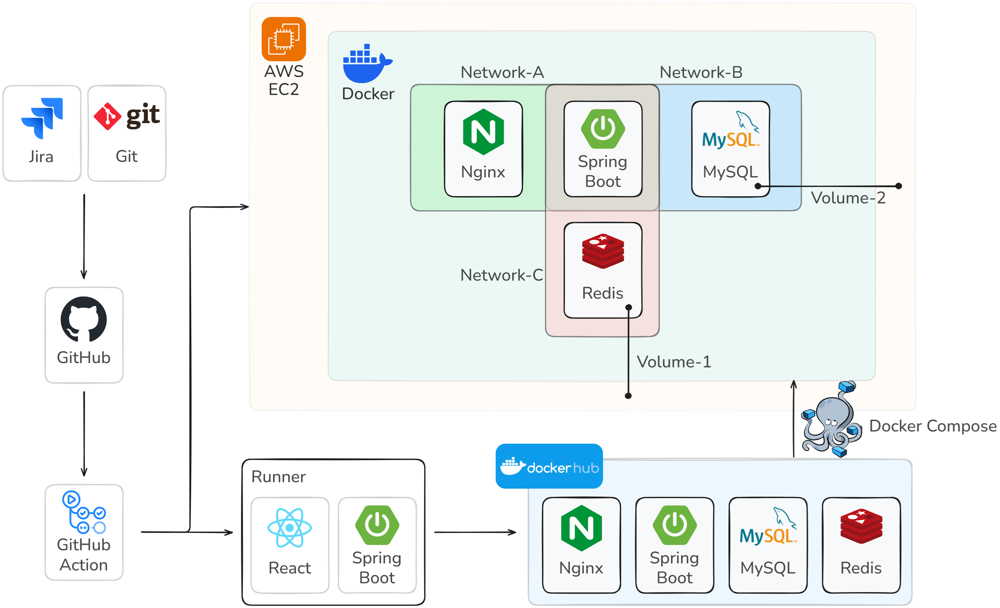
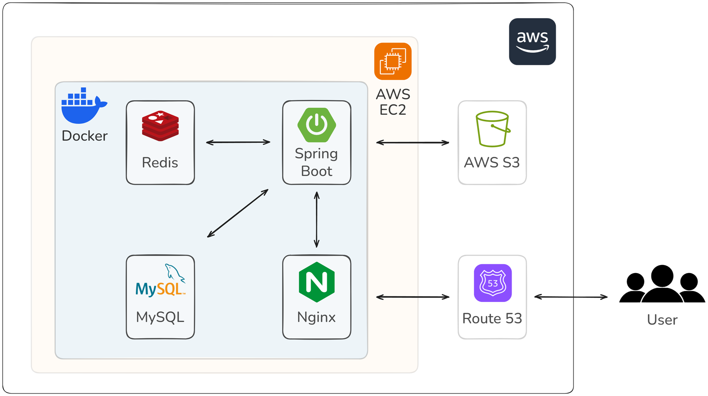

# 🏊🏻‍♂️ 오수완

### 서울 공공 수영장의 모든 것, 오수완에서 확인하세요!
 

> **오수완**은 서울 공공 수영장의 **자유 수영 운영 시간**과 이용자 리뷰를 **한눈에 볼 수 있는 서비스**입니다!
 

# 프로젝트 개요
- 프로젝트 기간: 2025.03.10. ~ 2025.04.03.
- 프로젝트 참여인원: 5명
 

# 기술 스택
- 프론트엔드 : React, Redux, Axios, Tailwind, React-Router
- 백엔드 : Spring Boot, JPA(Hibernate)
- 데이터베이스 : Redis, MySQL
- 인프라 : AWS(EC2, S3), Docker, GitHub Actions
- 버전 및 이슈 관리 : Git, Git Hooks, GitHub, Jira

 

# 담당
- 카카오맵 기반 공공수영장 마크(핀) 시각화 및 API 설계
- 수영장 별 상세 시간표 시각화 및 API 설계
- GitHub Actions 배포 자동화로 배포시간 3분 달성
 

# 아키텍처

### - CI/CD

### - 서비스 아키텍처

# 시연 영상

### 소셜로그인

### 지도 기반 수영장 찾기

### 수영장 찜하기

### 수영장 리뷰 작성

### 내가 작성한 리뷰 수정,삭제

### 수영장 자유수영 시간표 제보하기

# 🔗 참고 링크
- [GitHub Wiki](https://github.com/SesacDTeam/swim-done/wiki/%EC%B0%B8%EA%B3%A0-%EC%9E%90%EB%A3%8C)
